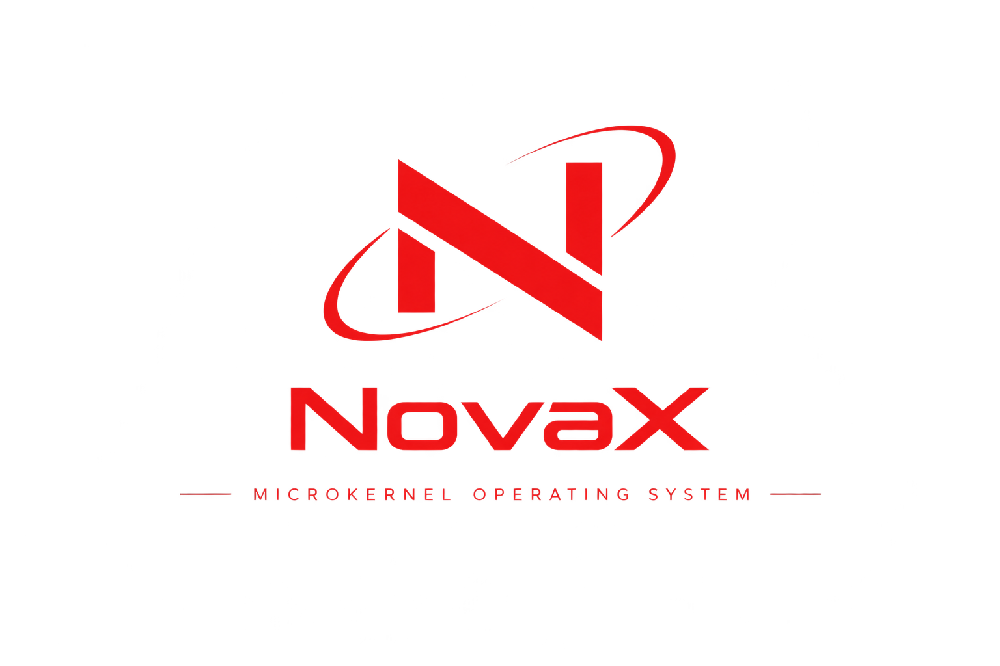

<p align="center">
  
</p>

<h1 align="center">NovaX</h1>

<p align="center">
  <b>Multicore Capability-Based Microkernel OS in Pure Rust</b><br>
  <code>#![no_std]</code> · <code>x86_64</code> · GPLv3 License · Part of <b>FreeMind Soft</b>
</p>

<p align="center">
  <a href="https://github.com"></a>
  <a href="https://github.com"></a>
  <a href="LICENSE"></a>
  <a href="https://github.com"></a>
</p>

<p align="center"><sub>v0.1.0 · Milestones 0–9 · <a href="docs/ARCHITECTURE.md">Architecture</a></sub></p>

---

## // 00 — PHILOSOPHY

NovaX keeps the kernel small and authority explicit.

- **No root.** There is no superuser, no `sudo`, no ambient authority. A server can touch only what its 16-slot capability space grants.
- **Capabilities, not names.** There are no global handles, no `/dev` namespace, no implicit access. Every syscall is checked against `cspace`.
- **Drivers are servers.** Serial, keyboard, shell, init and the virtio-net driver run in ring 3 and speak capability-checked IPC.
- **Zero bloat.** No libc, no VFS, no ACPI, no network stack in ring 0. `Heart` routes; userspace decides.

The result is a small multicore microkernel that is easy to audit and hard to accidentally over-privilege.

## // 01 — ARCHITECTURE

```
+----------------------------------------------------------------+
| RING 3 - SERVERS                                               |
|                                                                |
|   serial      kbd       init       shell       net             |
|   COM1/IRQ4   IRQ1      commands   line        ARP / ICMP      |
|      \         |          |          |          /              |
|       +--------+----------+----------+---------+               |
|                    capability-checked IPC                      |
+------------------------------|---------------------------------+
                               | syscall / message
+------------------------------|---------------------------------+
| RING 0 - HEART                                                 |
|                                                                |
|   paging   SMP   scheduler   IPC   capabilities   IRQ routing  |
|                                                                |
|   no drivers   no filesystem   no policy   no root             |
+----------------------------------------------------------------+
```

`Heart` owns only what cannot safely live in userspace: physical frames,
4-level paging, per-CPU scheduling, endpoint IPC, capability checks and
IRQ routing. Everything else is a ring-3 server.

### Capability space

```
cspace[16] = { kind, rights }

  Endpoint(id)      message queue
  Irq(n)            legacy ISA line
  IoPort(base,len)  bounded port window
  Dma(len)          bounded DMA window

  CAP_READ | CAP_WRITE | CAP_NOTIFY
```

A capability is the only way to reach a kernel object. There is no root
capability, no inheritance by name and no global port table.

## // 02 — QUICK START

### Dependencies

- Rust nightly `nightly-2025-06-01` (pinned by `rust-toolchain.toml`)
- target `x86_64-unknown-none`
- `xorriso`
- `qemu-system-x86_64`
- `git`, `make` and a C compiler (used by `tools/fetch_limine.sh`)

```bash
rustup toolchain install nightly-2025-06-01 \
  --component rust-src \
  --component llvm-tools-preview \
  --component rustfmt \
  --component clippy \
  --target x86_64-unknown-none
```

Debian/Ubuntu package names:

```bash
sudo apt install xorriso qemu-system-x86 build-essential git
```

### Build and boot

```bash
git clone https://github.com/wersanil/NovaX.git
cd novax

./tools/fetch_limine.sh
cargo build --release -p novax_heart
./tools/mkiso.sh
./tools/qemu_run.sh
```

`qemu_run.sh` boots `build/novax.iso` with q35, 2 CPUs and a user-mode
network backed by a legacy virtio-net device.

### Checks

| Script | What it proves |
|--------|----------------|
| `./tools/test.sh` | kernel self-tests; success is QEMU exit 33 |
| `./tools/m6_test.sh` | COM1 IRQ4 + PS/2 IRQ1 through IPC |
| `./tools/m7_test.sh` | `shell -> init -> shell`, `echo hello` |
| `./tools/m8_test.sh` | 2 CPUs, workers on cpu0/cpu1, M5–M7 regressions |
| `./tools/m9_test.sh` | virtio-net ARP + ICMP ping, M5–M8 regressions |

```bash
./tools/test.sh
./tools/m6_test.sh
./tools/m7_test.sh
./tools/m8_test.sh
./tools/m9_test.sh
```

## // 03 — REFERENCE BOOT LOG

Trimmed QEMU output from the M9 run (2 CPUs, virtio-net, ICMP ping):

```text
NovaX booting...
hhdm offset: 0xffff800000000000
memmap entries: 18
frames total: 130862, free: 130341
heap:  1024 KiB @ 0xffffffff90000000
ioapic: id=0, version=0x20, entries=24
lapic: bsp id=0, virt=0xffffffffb0000000
smp: 2 cpu(s) reported by limine
Milestone 5: OK
Milestone 6: userspace drivers spawned
Milestone 7: init + shell spawned
pci: virtio-net 1af4:1000 io=0xc040+0x20 irq=11
Milestone 9: virtio-net driver spawned
smp: cpu1 online
Milestone 8: smp online (2 of 2 cpu(s))
smp: worker A running on cpu 0
smp: worker B running on cpu 1
net: mac 52:54:00:12:34:56
net: link up
net: arp reply from 10.0.2.2
net: ping 10.0.2.2 seq=1 ok
net: ping 10.0.2.2 seq=2 ok
net: ping 10.0.2.2 seq=3 ok
net: ping 10.0.2.2 ok
```

## // 04 — REPOSITORY MAP

```
kernel/heart/      ring-0 microkernel: paging, SMP, scheduler, IPC, caps
kernel/memory/     frame allocator + 4-level paging (standalone no_std crate)
userspace/         ring-3 servers + common/abi.rs
tools/             Limine fetch, ISO build, QEMU checks
docs/              architecture notes and assets
```

Deep dive: [docs/ARCHITECTURE.md](docs/ARCHITECTURE.md).

## // 05 — STATUS

v0.1.0 is a working research kernel, not a general-purpose OS.

- Legacy virtio only; the net driver polls the used ring (no MSI-X).
- Networking is ARP + ICMP only; no DHCP, UDP or TCP.
- No process model (fork/exec/wait), no VFS, no ACPI, no SMAP/SMEP.
- Fixed limits: 16 caps per thread, 64-byte messages, 8 CPUs, one DMA window.

These are deliberate scope choices for an auditable core, not hidden
shortcuts. The full list lives in the architecture document.

## // 06 — FREEMIND SOFT

> **FreeMind Soft** — systems software, low-level engineering, open source.

- Author: [GitHub profile](https://github.com/wersanil) <!-- TODO: replace with the author profile URL -->
- Telegram: [FreeMind Soft Telegram](https://t.me/freemind_soft) <!-- TODO: replace with the channel URL -->

## // 07 — LICENSE

NovaX is released under the GNU General Public License v3.0.
See [LICENSE](LICENSE).

---

<p align="center"><sub>NovaX v0.1.0 · FreeMind Soft · small kernel, explicit authority</sub></p>
